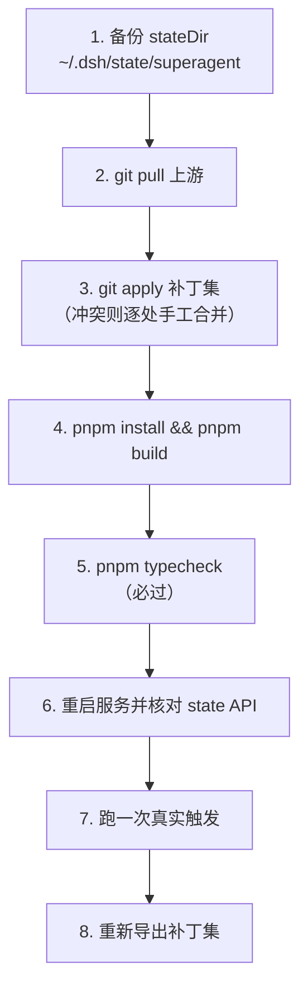

# 本地适配补丁集与升级 SOP

> 适用对象：`dsh-superagent-prototype` 的本地 fork（Windows + DSH 0.2.1-rc.5）
> 补丁文件：[../patches/dsh-superagent-windows-host.patch](../patches/dsh-superagent-windows-host.patch)
> 上游基线：`6337fc8 feat: add the dsh-superagent research prototype`
> 维护日期：2026-11-02 ｜ 配套文档：[evaluation.md](evaluation.md)

---

## 一、为什么需要这套补丁

原型以 Linux 为第一目标，直接在 Windows 上运行会遇到三类硬障碍：

1. **路径与文件语义**：绝对路径校验只认 `/` 开头；可执行 shim 只有 `#!/bin/sh` 形式。
2. **宿主契约漂移**：原型按旧版宿主写死工具名 `bash`，本机宿主 `0.2.1-rc.5` 已改为 `pwsh`，而宿主的 `tools.restrict()` 拒绝未知工具名——**插件因此完全不激活，API 全部 404**。
3. **原型自身缺陷**：删掉一个它读过的 issue 会让 GitHub 源持续报错 24 小时。

全部补丁均为**最小改动**，每处都带注释说明根因；其中 5 处仅在 Windows 或特定条件下生效，**不破坏上游 Linux 测试**。

---

## 二、补丁清单

| # | 文件 | 症状 | 根因 | 改法 |
| --- | --- | --- | --- | --- |
| 1 | `src/deployment.ts:13` | 插件校验失败不激活：`stateDir expect string to match regexp /^\//` | 绝对路径只认 POSIX | 正则改为 `/^(\/\|[A-Za-z]:[\\/])/`，同时接受盘符路径 |
| 2 | `src/policy.ts:94` | 执行目录校验同样只认 `/` | 同上 | `refine` 增加 `/^[A-Za-z]:[\\/]/` 分支 |
| 3 | `src/infra/environment.ts:93-121` | worker shim 不可执行 | 无扩展名文件对 PowerShell/PATHEXT 不可见 | 额外写出 `.cmd` 变体（`@echo off` + 去 PATH 环 + 透传参数与退出码） |
| 4 | `src/app/sessions.ts:263-266` | 插件不激活：`tools.restrict() names unknown global tool "bash"` | 工具名写死 | 白名单改为按 `tools.get(name, scopeParentOf(agent))` 过滤（本文件 `workOnly` 已用同一写法）；`noWait` 守卫同时识别 `pwsh` |
| 5 | `src/sources/github.ts:158-175` | 删除 issue 后源持续 `error` 达 24 小时 | 只把 HTTP 410 当作"线程已消失" | 新增 `gone()`：404 时先读一次仓库本身（`commands.api('')`），仓库仍可读即判定线程已消失，按 dropped 而非 failed 处理 |
| 6 | `src/sources/github.ts:243,399` + `src/sources/github-trigger.ts:62-72` | 单账号部署下**永远无法触发** | 原型跳过 agent 自己发布的内容（防自触发环），且这类内容 `human: false` 会被 `not_human` 拒绝 | 收窄放行：**自己发布且明确 @ 了 agent** 的评论才被接收，并按人类请求计入 |
| 7 | `src/app/http.ts:230-277` | 保存设置后管理 API 永久 404，必须重启整个 DSH 进程 | 宿主的 Web server 按**路径**存路由：重复注册抛错，disposer 也按路径删除。fiber 重启时新注册可能先于旧 disposer 执行 → 新注册被拒、旧 disposer 删掉路由 | 路由改为**进程级持有**：只注册一次，重启时换入当前 runtime 并重建路由表；旧 fiber 的 disposer 发现 runtime 已被接管则不删路由 |
| 8 | `src/app/runtime.ts:166-172` | 启动失败没有任何日志，只表现为 404/400 | `initialize()` 的失败只变成 `this.ready` 的未处理 rejection | 失败时写一条 `ctx.logger.error`，并继续拒绝 `ready` |
| 9 | `src/infra/diagnostics.ts`（新增）+ `src/app/runtime.ts`、`src/app/http.ts` | 宿主进程独立运行，日志行到不了启动它的终端，排查只能靠猜 | 插件没有自己的记录 | 插件把生命周期写进 `<stateDir>/diagnostics.log`（每行一个 JSON，有界）；`local/scripts/diagnose.mjs` 读它并给出结论 |
| 10 | `local/scripts/supervisor.mjs`（新增） | 官方服务脚本依赖 tmux（Windows 没有），且 `dsh.cmd` 实际拉起的是 `DeepSeek Harness.exe`，杀掉 shell 包装不会杀掉宿主 | 没有进程托管 | 守护脚本直接持有宿主进程（`ELECTRON_RUN_AS_NODE=1`），负责启动、崩溃自愈、停止与锁清理；分别记录守护与宿主的 pid |
| 11 | `src/infra/paths.ts` | 传入绝对路径时得到 `…\prompts\C:\Users\…\x.md` | `join` 不把绝对路径当作绝对路径 | 改用 `resolve`，它遇到绝对路径就以它为准 |
| 12 | `tests/portable.ts`（新增）+ `tests/docs.spec.ts`、`tests/runtime.spec.ts`、`tests/store.spec.ts`、`tests/commands.spec.ts`、`tests/service-script.spec.ts`、`tests/sources.spec.ts`、`tests/environment.spec.ts`、`tests/deployment.spec.ts` | Windows 上 41 个用例失败 | 测试假定 POSIX：符号链接、文件模式位、可执行脚本、信号、tmux，以及路径分隔符与行尾 | 便宜的直接修（分隔符、CRLF、git 引号、绝对路径）；确实需要 POSIX 的显式跳过并写明原因 |

### 补丁 12 之后的状态

```
Test Files  58 passed | 1 skipped (59)
     Tests  1163 passed | 34 skipped (1197)
```

34 个跳过的用例分属四类：tmux 服务脚本（15）、飞书事件消费者（写并运行 shell 脚本）、worker shim 的执行（POSIX sh 脚本）、POSIX 文件模式与信号。它们在 Linux 上照常运行。

### 关于补丁 10 踩到的三个坑

1. **DSH 宿主是单实例应用**：已有实例在跑时，新实例会立刻以 code 1 退出。守护必须先探测面板是否已有应答，再决定要不要拉起，否则会陷入"拉起→秒退→再拉起"的循环。
2. **pid 文件要分两个**：只记宿主 pid 时，`stop` 杀掉宿主后守护会立刻把它再拉起来，看起来"停不掉"。现在分别记录 `supervisor.pid` 与 `host.pid`，停止时先停守护再停宿主。
3. **被强杀的宿主会留下锁目录**（`<stateDir>.lock`），下一个实例会以 "Lock file is already being held" 拒绝启动。守护在每次拉起前清理它——这正是本次调试耗时最久的一个症状。

### 关于补丁 7 的机制

宿主 `webserver.register` 的实现是：

```js
register(route) {
  const table = route.kind === "exact" ? this.exact : this.prefixes
  if (table.has(route.path)) throw new Error(`webserver: duplicate ${route.kind} route "${route.path}"`)
  table.set(route.path, route)
  return () => { table.delete(route.path) }   // ← 按路径删，不按身份
}
```

fiber 重启时，旧 fiber 的 disposer 与新 fiber 的注册谁先执行并不确定：

- **新注册先执行** → `table.has('/orchestrator')` 为真 → 抛 duplicate → 新 Runtime 初始化失败 → 随后旧 disposer 按路径删掉路由 → **永久 404**；
- **旧 disposer 先执行** → 路由先被删 → 新注册成功 → 一切正常。

这解释了为什么现象是"有时正常、有时永久 404"。补丁把路由的所有权从"某个 fiber"移到"进程"：路由只注册一次，重启时只替换它服务的 runtime；旧 fiber 的 disposer 通过 runtime 身份判断自己是否已被接管。

> 踩过的坑：不能用 `ctx.webServer` 作为"是否同一个宿主"的键——它是每个 context 的代理，跨 fiber 不是同一对象，早期版本因此没能找到旧注册。

**验收**：`local/scripts/verify-restart-survival.mjs` 保存一个等价的 CLI 路径写法触发真实重启，并在重启期间每 2 秒探测一次管理 API。修复前 API 永久 404；修复后两次重启分别 23/23 与 15/15 次探测全部返回 200。

### 关于补丁 6 的安全性

放行范围严格限定为"由 agent 账号发布、且正文明确包含 `@<agent 登录名>`"的评论。agent 自己投递的回复带 `<!-- dsh-superagent:… -->` 标记但**不含 @**，因此不会自触发，反馈环防护仍然有效。

此补丁是"单账号部署"这一选择的必然补丁——原型官方建议使用专用 agent 账号，此时不需要它。拥有第二个账号后可以回退此补丁，改为验证"外部请求者"路径。

### 关于补丁 5 的必要性

上游注释写明"404 保留重试，因为它可能意味着私有仓库访问权被撤销"。补丁没有推翻这个意图，而是**在 404 时补一次判别**：读一次仓库本身，仍可读说明是这个 issue 没了（公开仓库删 issue 即如此），不可读才继续按"权限被撤销"重试。

---

## 三、补丁集的重放

### 重放验证记录（2026-11-02 实测）

以干净上游基线 `6337fc8` 建立 `git worktree` 做全流程演练：

| 步骤 | 结果 |
| --- | --- |
| `git apply --check` | ✅ 6 个文件全部校验通过 |
| `git apply` | ✅ 应用成功 |
| `pnpm install --offline` | ✅ 2.3s（依赖已在 pnpm store） |
| `pnpm typecheck` | ✅ `tsc --noEmit` 无错误 |
| `pnpm build` | ✅ 产出 11 个文件 / 695.75 kB |

演练结束后临时 worktree 已清理，主检出目录的本地改动未受影响。

### 首次应用（从干净上游开始）

```bash
cd D:/ProfessionalSoftware/project/dsh-super-agent/dsh-superagent-prototype
git apply --check ../patches/dsh-superagent-windows-host.patch   # 先试，不改文件
git apply ../patches/dsh-superagent-windows-host.patch
pnpm install --offline        # 依赖已在 pnpm store 中时优先用离线，避免注册表超时
pnpm build
```

> 注册表不稳定时 `pnpm install` 可能整体超时（此时 `pnpm typecheck`/`build` 会连带失败，报 "operation was aborted due to timeout"）。本机 pnpm store 已缓存全部依赖，`--offline` 可在 2 秒内完成安装。

### 校验补丁是否完整生效

```bash
cd D:/ProfessionalSoftware/project/dsh-super-agent/dsh-superagent-prototype

# 1) 六个文件都已修改
git diff --stat

# 2) 类型检查与构建通过
pnpm typecheck && pnpm build

# 3) 运行态：setup 必须解析成功、GitHub 源必须 ready
curl -s -H "x-orchestrator-request: 1" http://127.0.0.1:3082/orchestrator/api/state \
  | node -e "let s='';process.stdin.on('data',d=>s+=d);process.stdin.on('end',()=>{const j=JSON.parse(s);console.log('problem:',JSON.stringify(j.setup.problem));console.log('runtime:',j.health.runtime.state);console.log('github:',j.health.github.state)})"
```

期望输出：`problem: null`、`runtime: ready`、`github: ready`。

---

## 四、升级 SOP（跟随上游更新）



具体命令：

```bash
cd D:/ProfessionalSoftware/project/dsh-super-agent/dsh-superagent-prototype

# 1) 备份数据库（升级前必做：schema 只增不减，旧版打不开新库）
cp "$HOME/.dsh/state/superagent/orchestrator.sqlite" "$HOME/.dsh/state/superagent/orchestrator.sqlite.bak"

# 2) 取上游更新
git pull

# 3) 重放补丁（有冲突时 git apply 会逐个文件报错，按本文 §二 的说明手工合并）
git apply --3way ../patches/dsh-superagent-windows-host.patch

# 4)(5) 依赖、构建、类型检查
pnpm install --offline && pnpm build && pnpm typecheck

# 6) 重启服务
D:\ProfessionalSoftware\tools\dsh-superagent.cmd stop
D:\ProfessionalSoftware\tools\dsh-superagent.cmd start
D:\ProfessionalSoftware\tools\dsh-superagent.cmd status

# 8) 补丁有增补时，重新导出
git diff -- src/ > ../patches/dsh-superagent-windows-host.patch
```

**冲突高发点**：`src/sources/github.ts`（上游仍在活跃修改源逻辑）、`src/app/sessions.ts`（工具白名单与宿主版本强相关）。这两处冲突时，优先保留上游结构、只移植本文 §二 描述的语义。

---

## 五、已知未覆盖项：Windows 上失败的 41 个测试

`pnpm test` 在 Windows 上有 41/1197 失败（9 个测试文件），**全部为 POSIX 环境假设，与本补丁集无关**：

| 失败原因 | 例子 |
| --- | --- |
| 无符号链接权限 | `EPERM: operation not permitted, symlink …`（`tests/deployment.spec.ts`、`tests/environment.spec.ts`） |
| POSIX 文件模式位 | 断言 `stat.mode & 0o777 === 0o700`（`tests/store.spec.ts`） |
| 无扩展名 shim 不可执行 | `spawn gh ENOENT`——测试直接执行 `worker-bin/gh` |
| git 配置路径引号 | `file:"C:\\…"` 与 `file:C:\…` 差异 |
| 进程信号语义 | `tests/service-script.spec.ts` 依赖 POSIX 信号行为 |

**关键结论**：本补丁集**不破坏上游 Linux CI**——补丁 3 的 `.cmd` shim 仅在 `process.platform === 'win32'` 时写出；补丁 1/2 的正则仍拒绝 `relative/dir` 与 `~/dir`（上游测试对此有断言）。

Windows 上真正需要补的是测试基建（启用开发者模式以允许 symlink、跳过模式位断言、用 `.cmd` 代替无扩展名 shim），属于阶段 1 的工作项。

---

## 六、本地运行环境的配套产物

| 产物 | 位置 | 说明 |
| --- | --- | --- |
| gh CLI | `D:\ProfessionalSoftware\tools\gh\bin\gh.exe` | v2.103.3 便携版（winget 下载被网络拦截，改用 ghfast.top 镜像） |
| 凭据隔离包装器 | `D:\ProfessionalSoftware\tools\gh-agent-wrapper\gh-agent.exe` | 宿主用 `execFile`（无 shell）调 CLI，`.cmd`/shell 包装器在 Windows 不可用，必须是 exe。包装器设置 `GH_CONFIG_DIR` 后转发参数与退出码 |
| 启停脚本 | `D:\ProfessionalSoftware\tools\dsh-superagent.cmd` | 替代依赖 tmux 的官方脚本；含锁目录清理与端口回收 |
| 配置脚本 | `D:\ProfessionalSoftware\tools\dsh-superagent-config.mjs` | 通过管理 API 写 `source:github` / `policy` / `executor` |
| agent 凭据目录 | `C:\Users\26825\.config\gh-agent` | 与日常 gh 登录隔离 |
| worktree 源克隆 | `C:\Users\26825\src\widgets` | origin 指向真实 github.com（镜像为只读代理，推送必须直连） |
| DSH profile | `~/.dsh/profiles/superagent/` | 端口 3082；`stateDir=C:/Users/26825/.dsh/state/superagent` |

---

## 七、常见故障速查

| 现象 | 原因 | 处理 |
| --- | --- | --- |
| 插件不激活，API 全 404 | 宿主工具名与白名单不符，或路径校验失败 | 看启动日志的 "entries did not activate"；确认补丁 1/2/4 已应用 |
| `Lock file is already being held` | 进程被强杀，残留 `~/.dsh/state/superagent.lock` **目录** | `rmdir` 该目录后重启（启停脚本已内置） |
| `webserver (required) did not activate` | 端口 3082 被上一实例占用 | `taskkill //PID <pid> //T //F`（注意 `dsh.cmd` 实际拉起的是 `DeepSeek Harness.exe`） |
| 保存设置后 API 404 | 原型的进程内重启不重新注册路由 | 重启整个 DSH 进程（技术债 #5，待修） |
| GitHub 源 `error: gh: Not Found (HTTP 404)` | 补丁 5 未应用，或该 issue 被删且仓库不可读 | 确认补丁已应用；`gh api repos/<repo>` 手动验证 |
| 没有任何反应 | 当前是单账号 + 未启用评论流 | 需 `observeComments: true`（已默认开启），且评论必须含 `@<agent 登录名>` |
